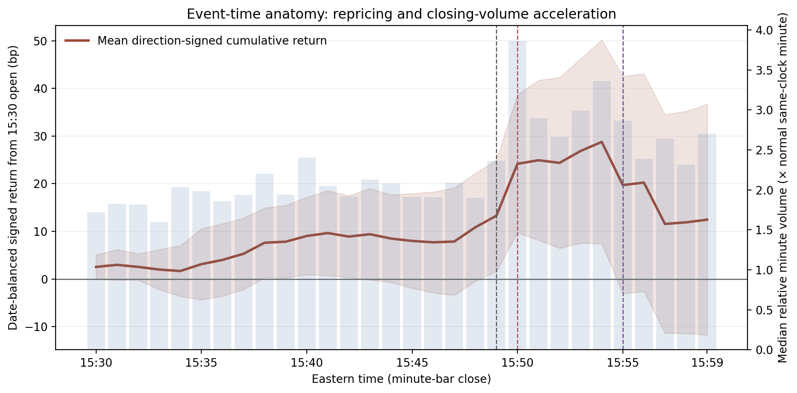
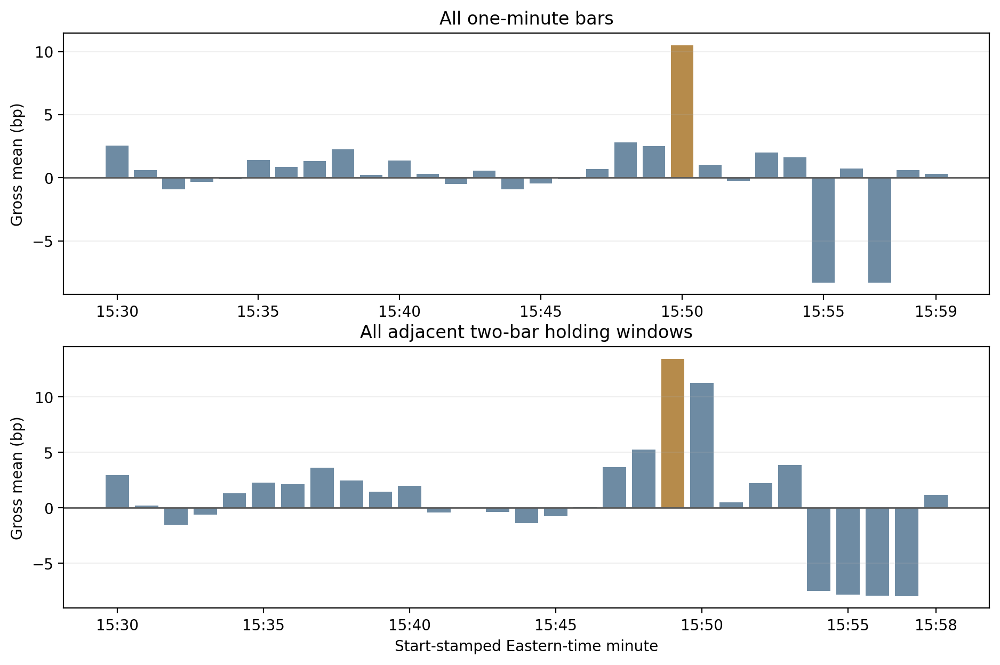

# MSCI Rebalance Event Study

**Where does index-inclusion price pressure live in the closing minutes, and how much of an apparent edge survives multiple-testing correction?**

 

## Research question

When MSCI adds or deletes a stock, index-tracking funds must trade it at the implementation close, which creates predictable, non-informational demand. Classic studies measure this effect over days. This project asks a sharper question at minute resolution: on the implementation day, *when* in the last ten minutes before the close does the price pressure show up, is it large enough to trade after costs, and which pre-entry market states tell us when it will appear? Review dates, not individual stocks, are treated as the independent observations, so every inference respects the fact that all names in one review share a common shock.

## Key findings

From the paper [*The 15:50 Burst: Minute-Level Price Pressure around MSCI U.S. Index Reconstitutions*](paper/msci_rebalance_closing_window_paper.pdf): 27 scheduled reviews from May 2020 to August 2026, 463 public addition/deletion events.

- **A naive closing-window rule loses money after costs.** Trading the add/delete direction from 15:49 to the daily close is negative once transaction costs are applied. The pressure is concentrated, not spread evenly across the window.
- **The pressure is a 15:50 burst.** Long additions and short deletions from the 15:49 open to the close of the 15:50 bar earn **13.54 bp gross per review** and **+0.97% cumulative after a 10 bp haircut**. The timing lines up with the start of exchange imbalance publication at 15:50.
- **Selection-adjusted inference keeps the claim honest.** Because the 15:50 minute was chosen after looking at the data, it is tested against every candidate minute with a four-review-block max-t procedure. It does not clear that bar (p = 0.164), so the study reports it as a strong candidate for a genuine holdout, not as confirmed alpha.
- **Pre-entry state carries information.** A gate built only from bars completed by 15:47 (stock momentum, SPY-relative movement, realized volatility, liquidity, same-clock relative volume, migration type) raises the active-date **hit rate from 70.6% to 87.5%** and cuts maximum drawdown from −0.42% to −0.12% while keeping 75.7% of baseline net profit.
- **The pseudo-out-of-sample test was pre-specified.** An expanding-window selector retains 74.0% of matched-baseline profit, against a prespecified 80% requirement, so the decision rule declines to promote it.

<p align="center"></p>
<p align="center"></p>

## Approach


Design choices that matter:
- **Information clock.** State features stop at the close of the 15:47 bar, leaving an operational buffer before a 15:49 entry.
- **Bar stamping.** Minute bars are start-stamped (the `15:50` bar covers 15:50:00–15:50:59), and the code enforces this throughout.
- **Unit of observation.** Review dates are the independent observations; all confidence intervals use review-level blocks.
- **Frozen specifications.** Each optimization (state filters, soft gates, portfolio constructions) is frozen in a JSON spec under `configs/` before it is run, and an independent re-implementation audits the reported numbers from raw bars.

## Repository layout

| Path | Contents |
|---|---|
| `src/msci_rebalance/` | Event parsing, ticker resolution, backtest engine, state filters, weighting, volatility diagnostics, inference |
| `scripts/` | Pipeline entry points: build the event universe, download bars, run the backtest and every extension, audits, charts, paper builder |
| `configs/` | Frozen specifications for the state-filter, soft-gate and portfolio-optimization studies |
| `data/events/` | The review calendar and hand-audited ticker overrides (the MSCI constituent lists themselves are not redistributed) |
| `tests/` | Unit tests for events, backtest, weighting, state filters, attribution and optimization |
| `paper/` | The research paper (PDF) |
| `figures/` | Key charts |

## Reproducing

```bash
python -m venv .venv && source .venv/bin/activate
pip install -e .
python -m pytest -q                      # unit tests, synthetic fixtures only
```

The full pipeline needs two inputs that are not redistributed here:
1. **MSCI public review announcements** (PDFs from msci.com). `scripts/build_event_universe.py` parses them and reconciles each review's USA addition/deletion counts against the PDF summary; `scripts/finalize_ticker_map.py` then applies the audited overrides in `data/events/`.
2. **Minute and daily bars** from MarketData.app. Set `MARKETDATA_TOKEN` (see `.env.example`) and run `scripts/download_marketdata.py`.

Then:

```bash
PYTHONPATH=src python scripts/run_backtest.py \
  --events data/events/msci_us_standard_events_resolved.csv \
  --marketdata-dir data/marketdata --output-dir outputs/baseline
PYTHONPATH=src python scripts/run_first_minute_alpha.py \
  --ledger outputs/baseline/trade_ledger.csv \
  --event-time-security outputs/baseline/event_time_security_panel.csv \
  --marketdata-dir data/marketdata --output-dir outputs/baseline
PYTHONPATH=src python scripts/run_state_filter_research.py \
  --spec configs/state_filter_spec.json --output-dir outputs/baseline
```

The other extensions (flow weighting, volatility diagnostics, soft-gate optimization, portfolio variants, deep portfolio optimization) each have a script of the same name in `scripts/`.

## Paper

[`paper/msci_rebalance_closing_window_paper.pdf`](paper/msci_rebalance_closing_window_paper.pdf): *The 15:50 Burst: Minute-Level Price Pressure around MSCI U.S. Index Reconstitutions. Point-in-Time Event Construction, Review-Date Inference, and an Exploratory Top-10 Portfolio.* Siyan Chen, September 2026.

MSCI index data and documents are the property of MSCI Inc. This repository contains research code only and is not investment advice.

## Author

Siyan Chen · University of California, Santa Barbara · siyan_chen@ucsb.edu
